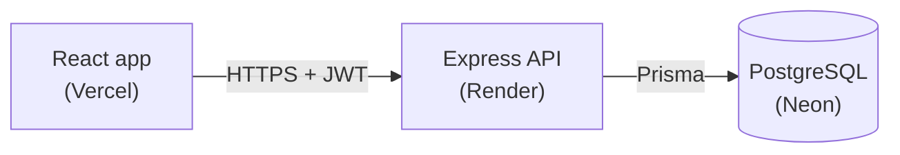
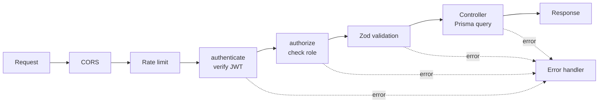

# Student Management System

A full-stack web app for managing student records, with login, role-based permissions, search and pagination.

**Live demo:** https://student-management-one-pink.vercel.app
**API:** https://student-management-api-jsjk.onrender.com/health

> The API runs on a free tier and sleeps after 15 minutes without traffic. The first request after a quiet period can take up to a minute while it wakes up.


## Try it

| Account | Email | Password | Can do |
|---|---|---|---|
| Admin | `admin@demo.com` | `DemoAdmin123` | View, add, edit and delete students |
| Viewer | `viewer@demo.com` | `DemoViewer123` | View and search students only |

You can also create your own account on the register page. New accounts are always read-only viewers.

These credentials are public, so anyone can change the demo data. Please don't reuse these passwords anywhere real.

## Features

- Create, read, update and delete students
- Search by name, email or roll number, with a debounced search box
- Server-side pagination
- Register and login with JWT authentication, and bcrypt password hashing
- Two roles: **Admin** can change data, **Viewer** is read-only (enforced on the server, not just hidden in the UI)
- Validation on the server with Zod, with errors shown under the matching form field
- A central error handler that returns clean JSON for validation errors, duplicates and missing records
- Rate limiting on login and registration
- Responsive UI with loading, empty and error states, toast messages and a delete confirmation dialog
- Automated API tests with Jest and Supertest
- A seed script for demo accounts and sample data

## Screenshots

| Login | Validation errors |
|---|---|
|  |  |

| Delete confirmation | Viewer role (read-only) |
|---|---|
|  |  |


## Tech stack

| Layer | Technology |
|---|---|
| Frontend | React, Vite, React Router, Tailwind CSS |
| Backend | Node.js, Express |
| Database | PostgreSQL with Prisma ORM |
| Auth | JWT, bcryptjs |
| Validation | Zod |
| Testing | Jest, Supertest |
| Hosting | Vercel (frontend), Render (API), Neon (database) |

## Architecture



A request to a protected route passes through these steps in order:



## Project structure

```
client/                 React app
  src/
    components/         Layout, ProtectedRoute, StudentForm, PasswordInput, ConfirmDialog
    context/            Auth and toast providers
    hooks/              useDebounce
    lib/api.js          Fetch helper (base URL, JSON, Bearer token, errors)
    pages/              Login, Register, Students, StudentFormPage
server/                 Express API
  prisma/               Schema and migrations
  scripts/seed.js       Demo data
  src/
    config/             Environment checks
    controllers/        Request handling
    middleware/         authenticate, authorize, rate limiters, error handler
    routes/             Route definitions
    validators/         Zod schemas
  tests/                Jest + Supertest
```

## Design decisions and known limitations

- **Authorization is enforced on the server.** The UI hides controls from viewers, but the API itself returns `403` for any write by a viewer.
- **Passwords are never stored in plain text.** They are hashed with bcrypt, and the API never returns the hash.
- **The login error is the same for a wrong password and an unknown email,** so the endpoint can't be used to find out which emails have accounts.
- **The JWT is stored in `localStorage`.** This is simple, but any script running on the page could read it. An httpOnly cookie would be safer in production, at the cost of extra CORS and CSRF handling.
- **Roles are stored inside the token,** so a role change only takes effect at the next login or when the token expires (one day).
- **Rate-limit counters are kept in memory,** so they reset when the server restarts and aren't shared between instances. A shared store such as Redis would be the next step for several servers.
- **Public sign-up** means anyone can create a read-only account. That suits a demo with fake data. For real records, user creation would be admin-only.
- **Prisma 6 is used on purpose.** Upgrading to Prisma 7 is tracked as a separate issue.

## Documentation

API documentation and local setup instructions are coming in the next sections.