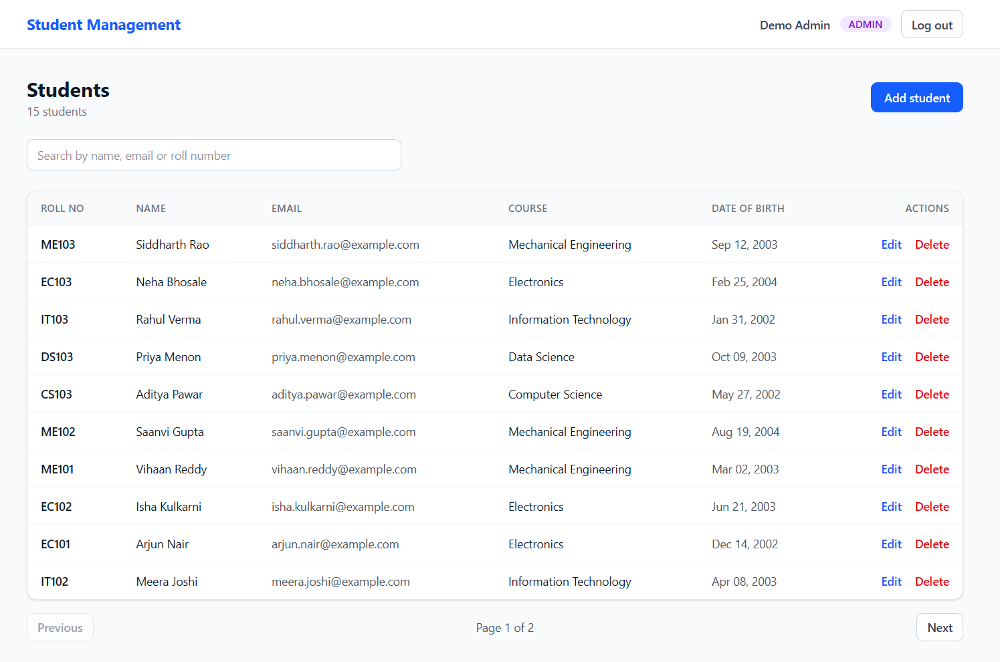
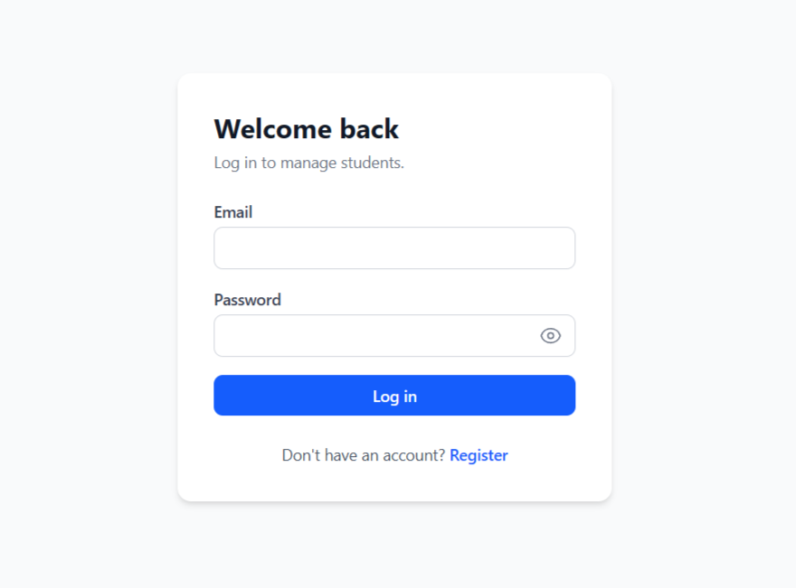
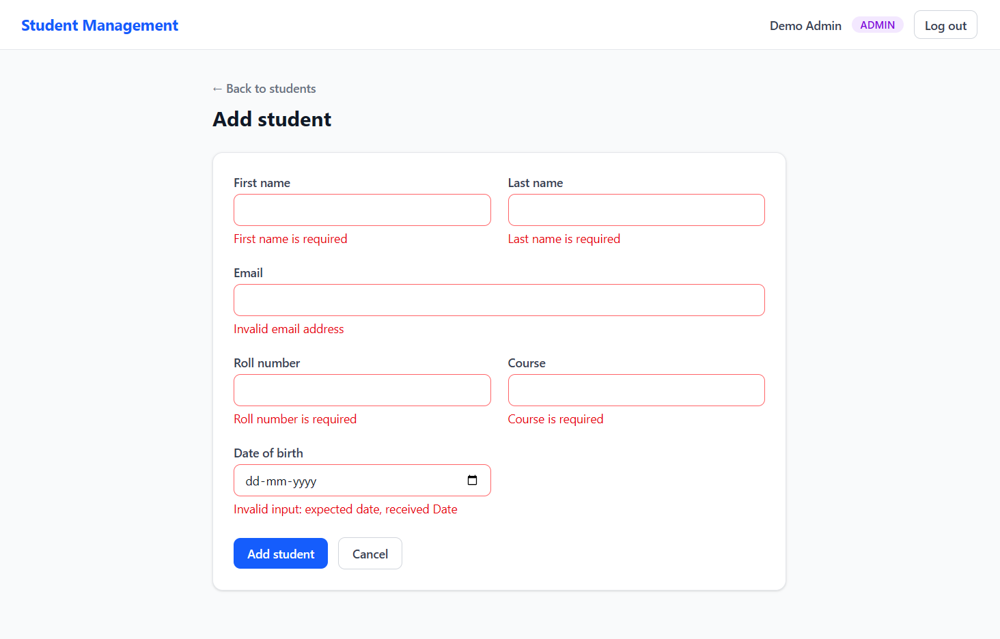
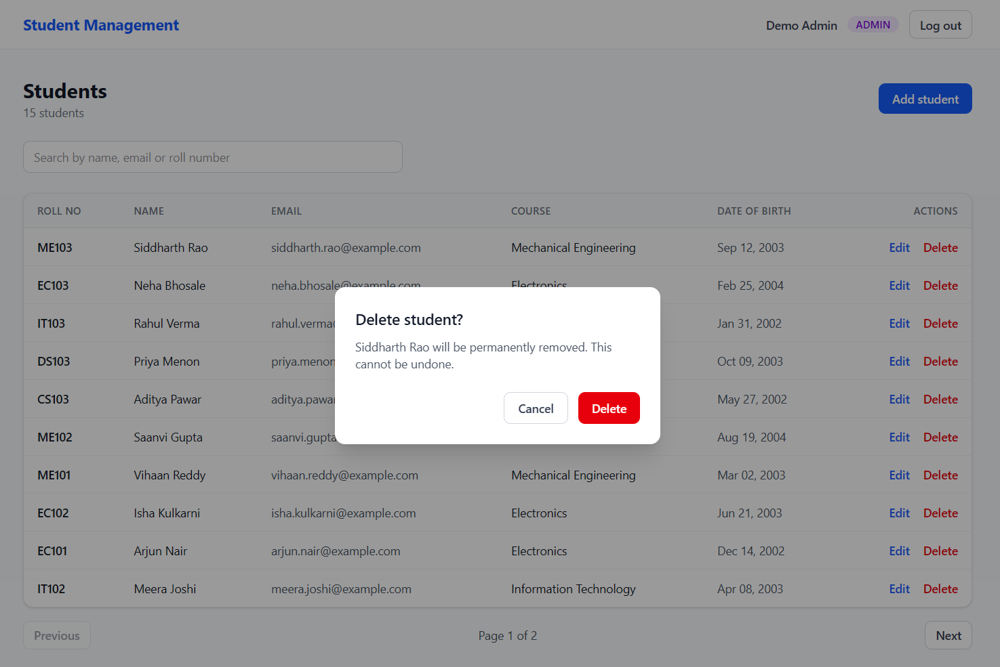
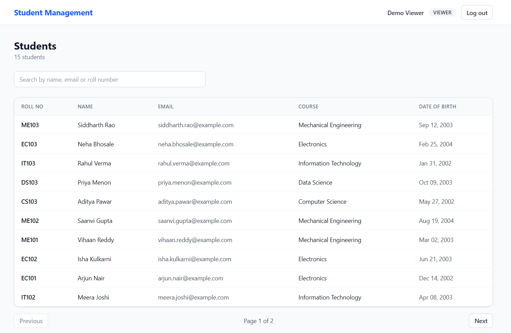
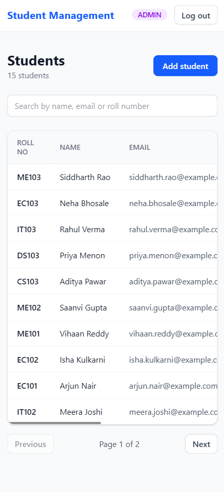
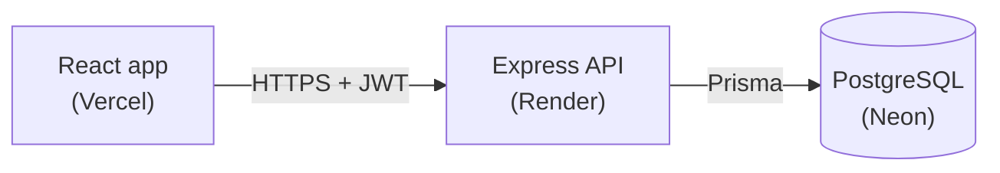
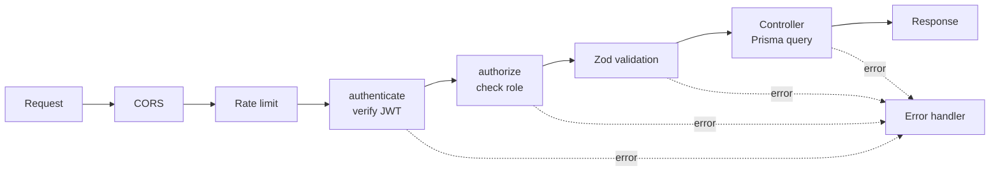

# Student Management System

A full-stack web app for managing student records, with login, role-based permissions, search and pagination.

**Live demo:** https://student-management-one-pink.vercel.app
**API:** https://student-management-api-jsjk.onrender.com/health

> The API runs on a free tier and sleeps after 15 minutes without traffic. The first request after a quiet period can take up to a minute while it wakes up.



## Try it

| Account | Email | Password | Can do |
|---|---|---|---|
| Admin | `admin@demo.com` | `DemoAdmin123` | View, add, edit and delete students |
| Viewer | `viewer@demo.com` | `DemoViewer123` | View and search students only |

You can also create your own account on the register page. New accounts are always read-only viewers.

These credentials are public, so anyone can change the demo data. Please don't reuse these passwords anywhere real.

## Features

- Create, read, update and delete students
- Search by name, email or roll number, with a debounced search box
- Server-side pagination
- Register and login with JWT authentication, and bcrypt password hashing
- Two roles: **Admin** can change data, **Viewer** is read-only (enforced on the server, not just hidden in the UI)
- Validation on the server with Zod, with errors shown under the matching form field
- A central error handler that returns clean JSON for validation errors, duplicates and missing records
- Rate limiting on login and registration
- Responsive UI with loading, empty and error states, toast messages and a delete confirmation dialog
- Automated API tests with Jest and Supertest
- A seed script for demo accounts and sample data

## Screenshots

| Login | Validation errors |
|---|---|
|  |  |

| Delete confirmation | Viewer role (read-only) |
|---|---|
|  |  |



## Tech stack

| Layer | Technology |
|---|---|
| Frontend | React, Vite, React Router, Tailwind CSS |
| Backend | Node.js, Express |
| Database | PostgreSQL with Prisma ORM |
| Auth | JWT, bcryptjs |
| Validation | Zod |
| Testing | Jest, Supertest |
| Hosting | Vercel (frontend), Render (API), Neon (database) |

## Architecture



A request to a protected route passes through these steps in order:



## Project structure

```
client/                 React app
  src/
    components/         Layout, ProtectedRoute, StudentForm, PasswordInput, ConfirmDialog
    context/            Auth and toast providers
    hooks/              useDebounce
    lib/api.js          Fetch helper (base URL, JSON, Bearer token, errors)
    pages/              Login, Register, Students, StudentFormPage
server/                 Express API
  prisma/               Schema and migrations
  scripts/seed.js       Demo data
  src/
    config/             Environment checks
    controllers/        Request handling
    middleware/         authenticate, authorize, rate limiters, error handler
    routes/             Route definitions
    validators/         Zod schemas
  tests/                Jest + Supertest
```

## Design decisions and known limitations

- **Authorization is enforced on the server.** The UI hides controls from viewers, but the API itself returns `403` for any write by a viewer.
- **Passwords are never stored in plain text.** They are hashed with bcrypt, and the API never returns the hash.
- **The login error is the same for a wrong password and an unknown email,** so the endpoint can't be used to find out which emails have accounts.
- **The JWT is stored in `localStorage`.** This is simple, but any script running on the page could read it. An httpOnly cookie would be safer in production, at the cost of extra CORS and CSRF handling.
- **Roles are stored inside the token,** so a role change only takes effect at the next login or when the token expires (one day).
- **Rate-limit counters are kept in memory,** so they reset when the server restarts and aren't shared between instances. A shared store such as Redis would be the next step for several servers.
- **Public sign-up** means anyone can create a read-only account. That suits a demo with fake data. For real records, user creation would be admin-only.
- **Prisma 6 is used on purpose.** Upgrading to Prisma 7 is tracked as a separate issue.

## API documentation

Base URL: `https://student-management-api-jsjk.onrender.com`

All request and response bodies are JSON. Protected routes need the header `Authorization: Bearer <token>`, where the token comes from `POST /api/auth/login`.

### Endpoints

| Method | Path | Auth | Description |
|---|---|---|---|
| GET | `/health` | Public | Health check |
| POST | `/api/auth/register` | Public | Create a viewer account |
| POST | `/api/auth/login` | Public | Log in and receive a JWT |
| GET | `/api/auth/me` | Any user | Current user |
| GET | `/api/students` | Any user | List students (paginated, searchable) |
| GET | `/api/students/:id` | Any user | Get one student |
| POST | `/api/students` | **Admin** | Create a student |
| PUT | `/api/students/:id` | **Admin** | Replace a student's fields |
| DELETE | `/api/students/:id` | **Admin** | Delete a student |

### Authentication

#### `POST /api/auth/register`

Creates an account. The role is always `VIEWER`, and any `role` field in the request is ignored. Limited to 10 sign-ups per IP per hour.

```json
{ "name": "Test User", "email": "test@example.com", "password": "password123" }
```

| Field | Rule |
|---|---|
| `name` | Required |
| `email` | Valid email, unique |
| `password` | At least 8 characters |

**201 Created**

```json
{
  "id": 3,
  "name": "Test User",
  "email": "test@example.com",
  "role": "VIEWER",
  "createdAt": "2026-11-06T10:15:30.000Z"
}
```

Errors: `400` validation failed, `409` email already registered, `429` too many sign-ups.

#### `POST /api/auth/login`

```json
{ "email": "admin@demo.com", "password": "DemoAdmin123" }
```

**200 OK**

```json
{
  "token": "eyJhbGciOi...",
  "user": { "id": 1, "name": "Demo Admin", "email": "admin@demo.com", "role": "ADMIN" }
}
```

The token expires after one day. Errors: `400` validation failed, `401` invalid email or password (the same message for both cases), `429` after 5 failed attempts from one IP in 15 minutes.

#### `GET /api/auth/me`

Returns the logged-in user: `id`, `name`, `email`, `role`, `createdAt`. Errors: `401`.

### Students

A student looks like this:

```json
{
  "id": 1,
  "firstName": "Aarav",
  "lastName": "Sharma",
  "email": "aarav.sharma@example.com",
  "rollNumber": "CS101",
  "course": "Computer Science",
  "dateOfBirth": "2003-02-11T00:00:00.000Z",
  "createdAt": "2026-11-06T09:00:00.000Z",
  "updatedAt": "2026-11-06T09:00:00.000Z"
}
```

#### `GET /api/students`

| Query parameter | Default | Description |
|---|---|---|
| `page` | `1` | Page number |
| `limit` | `10` | Page size, maximum 100 |
| `search` | none | Case-insensitive match on first name, last name, email or roll number |

Results are sorted newest first.

**200 OK**

```json
{
  "data": [ { "id": 15, "firstName": "Siddharth", "...": "..." } ],
  "pagination": { "page": 1, "limit": 10, "total": 15, "totalPages": 2 }
}
```

#### `GET /api/students/:id`

Returns one student. Errors: `400` id is not a number, `404` not found.

#### `POST /api/students` (admin)

```json
{
  "firstName": "Tanvi",
  "lastName": "Mehta",
  "email": "tanvi.mehta@example.com",
  "rollNumber": "CS201",
  "course": "Computer Science",
  "dateOfBirth": "2003-08-15"
}
```

| Field | Rule |
|---|---|
| `firstName`, `lastName`, `course` | Required |
| `email` | Valid email, unique |
| `rollNumber` | Required, unique |
| `dateOfBirth` | A valid date, not in the future |

**201 Created** returns the student. Errors: `400` validation failed, `403` not an admin, `409` duplicate email or roll number.

#### `PUT /api/students/:id` (admin)

Takes the same body and rules as create. All fields are required, because this replaces the student's data. **200 OK** returns the updated student. Errors: `400`, `403`, `404`, `409`.

#### `DELETE /api/students/:id` (admin)

**204 No Content** with an empty body. Errors: `400`, `403`, `404`.

### Error format

Every error is JSON with a `message`. Validation errors also list the failing fields:

```json
{
  "message": "Validation failed",
  "errors": [
    { "field": "email", "message": "Invalid email address" },
    { "field": "firstName", "message": "First name is required" }
  ]
}
```

| Status | Meaning |
|---|---|
| `400` | Invalid input, bad id, or malformed JSON |
| `401` | Missing, invalid or expired token, or wrong login |
| `403` | Logged in, but the role isn't allowed |
| `404` | Student not found |
| `409` | Duplicate email or roll number |
| `429` | Rate limit hit |
| `500` | Unexpected server error (details are logged, not returned) |
git branch
git status
git add README.md
git commit -m "docs: add API documentation"
git push -u origin docs/api-documentation
git log --oneline -2